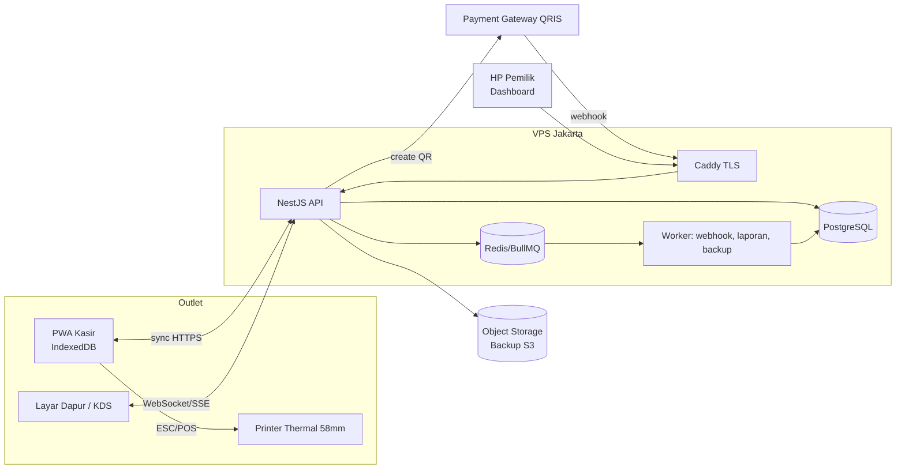
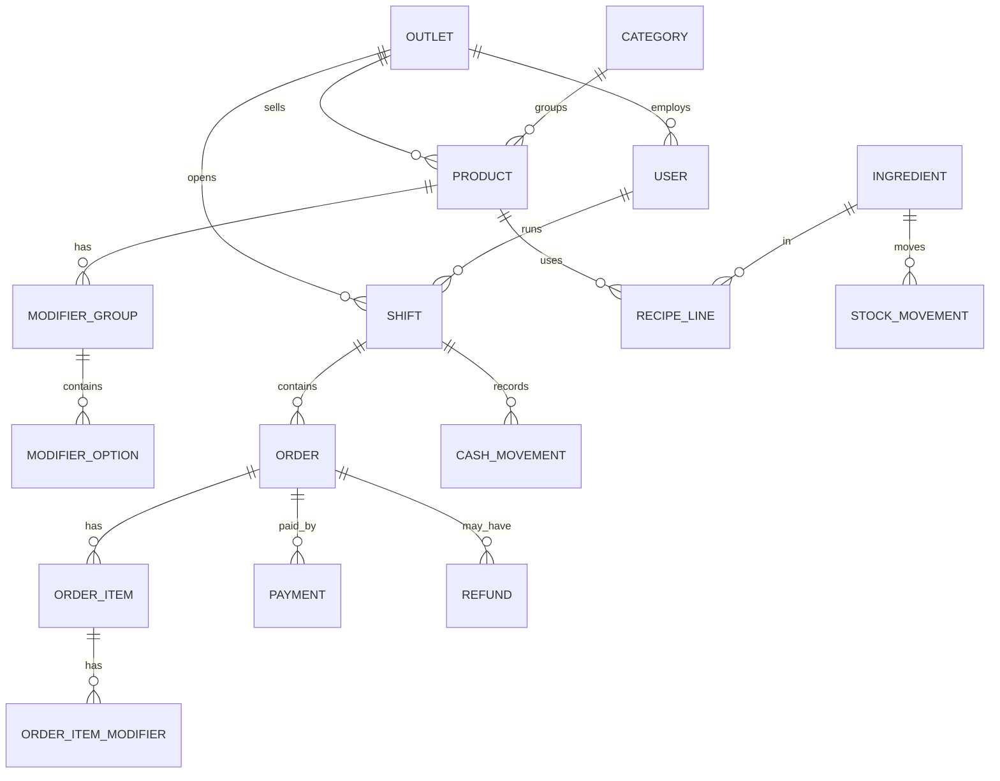
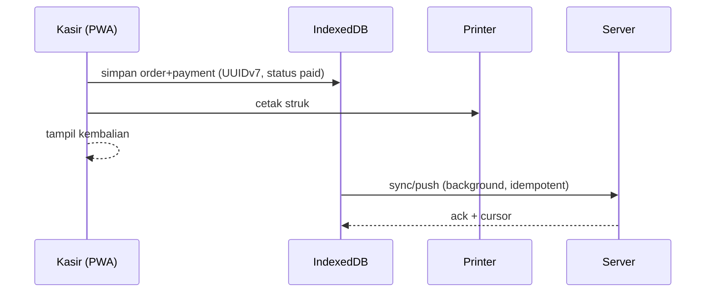

# Blueprint: Cassier — Aplikasi Kasir Warung Bakso

> Versi 1.0 · Status: Draft untuk persetujuan · Pemilik: Abati Technology
> Cakupan: dari discovery sampai produksi dan operasi.

---

## 1. Ringkasan Eksekutif

| Item | Keputusan |
|---|---|
| Produk | POS (point of sale) kasir untuk warung bakso: 1 outlet awal, siap multi-outlet |
| Prinsip utama | **Offline-first**, cepat (≤3 tap per item), murah dioperasikan, tahan koneksi buruk |
| Perangkat | HP/tablet Android (kasir), printer thermal 58mm Bluetooth, laptop/HP pemilik (dashboard) |
| Bentuk aplikasi | PWA (installable) + backend API |
| Pembayaran | Tunai, QRIS dinamis (via payment gateway), transfer manual (dicatat) |
| Arsitektur | Modular monolith + PostgreSQL; bukan microservices (YAGNI untuk skala warung) |
| Target MVP | 6 minggu, 1 outlet live |
| Biaya infra | ± Rp300–600rb/bulan (lihat §15) |

**Masalah yang diselesaikan:** pencatatan manual rawan salah, kebocoran kas, stok bahan (daging, mie, bihun) tak terpantau, tidak ada laporan harian, antrian jam makan siang lambat.

---

## 2. Aktor dan Kebutuhan

| Aktor | Kebutuhan inti |
|---|---|
| **Kasir** | Input pesanan cepat, bayar tunai/QRIS, cetak struk, buka/tutup shift |
| **Pelayan/Dapur** | Lihat antrian pesanan (KDS sederhana), tandai selesai |
| **Manajer** | Void/refund (dengan PIN), kelola menu & harga, stok masuk, opname |
| **Pemilik** | Laporan penjualan, laba kotor, selisih kas, stok kritis (dari HP, kapan saja) |
| **Sistem** | Sinkronisasi, backup, rekonsiliasi pembayaran QRIS |

---

## 3. Ruang Lingkup

### 3.1 MVP (Fase 1) — wajib
1. Login PIN per pengguna + peran (RBAC)
2. Katalog menu: kategori, produk, varian/modifier (porsi, level pedas, tanpa mie/ganti bihun, extra topping)
3. Transaksi: keranjang, catatan, tipe order (makan di tempat/bungkus), nomor meja/antrian, diskon
4. Pembayaran: tunai (kembalian), QRIS, split bayar sederhana
5. Struk thermal 58mm + struk digital (link/WA)
6. Shift kasir: modal awal, kas masuk/keluar, tutup shift + selisih
7. Void/refund dengan otorisasi PIN manajer + audit
8. Mode offline penuh + sinkronisasi otomatis
9. Laporan harian: omzet, item terlaris, metode bayar, per jam
10. Backup otomatis + monitoring dasar

### 3.2 Fase 2
- Inventori bahan baku + resep (BOM), stok otomatis berkurang, opname, peringatan stok minimum
- Kitchen Display (KDS) / tiket dapur
- Pembelian/supplier, HPP & laba kotor
- Integrasi GoFood/GrabFood/ShopeeFood (input manual → API bila tersedia)

### 3.3 Fase 3
- Multi-outlet, dashboard konsolidasi
- Loyalti/member, voucher
- Integrasi akuntansi (ekspor ke Jurnal/Accurate/Excel)
- Prediksi kebutuhan stok (rata-rata bergerak per hari-dalam-pekan)

### 3.4 Di luar lingkup
Payroll, reservasi meja, aplikasi pelanggan self-order (dievaluasi pasca Fase 3).

---

## 4. Kebutuhan Non-Fungsional

| Kategori | Target |
|---|---|
| Kecepatan | Tambah item ≤100 ms (lokal); checkout tunai ≤3 detik dari tombol Bayar ke struk |
| Ketersediaan | Kasir tetap berfungsi 100% tanpa internet; API SLO 99,5%/bulan |
| Durabilitas | RPO ≤ 15 menit, RTO ≤ 2 jam |
| Keamanan | RBAC, PIN ter-hash, TLS, audit log immutable, mematuhi UU PDP No. 27/2022 |
| Skalabilitas | Rancang untuk 10 outlet × 1.000 transaksi/hari tanpa ubah arsitektur |
| Usability | Dipakai karyawan tanpa pelatihan >30 menit; tombol ≥48px; mode terang kontras tinggi |
| Observability | Log terstruktur, metrik, error tracking, alert ke WhatsApp/Telegram |
| Kompatibilitas | Android 9+/Chrome 100+, layar 6"–10" |

---

## 5. Arsitektur

### 5.1 Pilihan teknologi (rekomendasi final)

| Lapisan | Pilihan | Alasan |
|---|---|---|
| Frontend | React 19 + TypeScript + Vite, PWA (Workbox) | Ekosistem luas, installable, offline |
| State/Data lokal | Dexie (IndexedDB) + TanStack Query | Antrian offline, query cepat |
| UI | Tailwind + shadcn/ui | Konsisten, cepat dibangun |
| Backend | Node.js 22 + NestJS (modular) + Fastify adapter | Struktur modul tegas, tipe aman |
| ORM/Migrasi | Prisma (atau Drizzle) | Migrasi terversi |
| Database | PostgreSQL 16 | ACID, JSONB, row-level fleksibel |
| Cache/Queue | Redis + BullMQ (mulai Fase 1 hanya untuk job webhook & laporan) | Retry, penjadwalan |
| Printer | ESC/POS via Web Bluetooth/WebUSB; fallback app RawBT | Tanpa app native |
| Pembayaran | Xendit atau Midtrans (QRIS dinamis + webhook) | Rekonsiliasi otomatis |
| Infra | Docker Compose di VPS Jakarta, Caddy (TLS otomatis) | Sederhana, murah |
| CI/CD | GitHub Actions → GHCR → deploy SSH/Watchtower | Otomatis, terlacak |
| Monitoring | Sentry + Uptime Kuma + Grafana Cloud (free tier) | Murah |

> Alternatif: Flutter bila perangkat tertentu butuh Bluetooth printer native yang stabil. Evaluasi di *spike* Minggu 1 (lihat §14). Keputusan dicatat sebagai ADR-001.

### 5.2 Diagram konteks



### 5.3 Modul backend (modular monolith)

| Modul | Tanggung jawab |
|---|---|
| `auth` | Login PIN/password, JWT, refresh, RBAC |
| `catalog` | Kategori, produk, modifier, harga, ketersediaan |
| `orders` | Order, item, status, nomor antrian |
| `payments` | Pembayaran, integrasi gateway, webhook, rekonsiliasi |
| `shifts` | Shift, kas masuk/keluar, selisih |
| `inventory` | Bahan, resep, mutasi stok, opname (Fase 2) |
| `reports` | Agregasi harian/bulanan, ekspor CSV/PDF |
| `sync` | Endpoint push/pull, resolusi konflik |
| `audit` | Log append-only |
| `printing` | Template struk (render ESC/POS di klien, template dari server) |

Aturan: antar-modul hanya lewat interface/service publik, tidak akses tabel modul lain langsung. Memudahkan ekstraksi di masa depan bila perlu.

---

## 6. Strategi Offline-First & Sinkronisasi

**Prinsip:** transaksi = *append-only events*; master data = *last-write-wins* dengan versi.

1. **ID sisi klien:** UUIDv7 untuk order/pembayaran (urut waktu, tanpa tabrakan).
2. **Outbox:** setiap perubahan ditulis ke IndexedDB + tabel `outbox` (status `pending/sent/failed`).
3. **Push:** `POST /sync/push` batch dengan `Idempotency-Key` per mutasi → server menolak duplikat dengan aman.
4. **Pull:** `GET /sync/pull?since=<cursor>` untuk master data (menu, harga, user) dengan cursor `updated_at, id`.
5. **Konflik:**
   | Data | Aturan |
   |---|---|
   | Order/pembayaran | Tidak pernah ditimpa; koreksi lewat void/refund baru |
   | Menu/harga | LWW berdasarkan `version`; server menang |
   | Stok | Server otoritatif; klien hanya kirim mutasi (delta), bukan nilai absolut |
   | Nomor antrian | Prefix perangkat + counter harian lokal (mis. `A-014`) agar unik tanpa server |
6. **Retry:** exponential backoff + jitter; indikator status sinkron (hijau/kuning/merah) di header.
7. **Pembayaran QRIS saat offline:** tidak tersedia → UI menonaktifkan, menawarkan tunai/transfer manual. QR statis opsional dengan konfirmasi manual (ditandai `manual_verified`).
8. **Retensi lokal:** 30 hari transaksi tersinkron; data belum tersinkron tidak pernah dihapus.
9. **Jam perangkat:** server menyimpan `client_created_at` dan `server_received_at`; laporan memakai waktu server bila selisih > 5 menit.

---

## 7. Model Data

### 7.1 ERD



### 7.2 Skema inti (PostgreSQL)

```sql
-- Semua uang disimpan sebagai BIGINT dalam rupiah (tanpa desimal) — hindari float.
CREATE TABLE outlet (
  id UUID PRIMARY KEY, name TEXT NOT NULL, address TEXT,
  tax_mode TEXT NOT NULL DEFAULT 'none',          -- none | pb1_inclusive | pb1_exclusive
  tax_rate_bp INT NOT NULL DEFAULT 0,             -- basis point: 1000 = 10%
  timezone TEXT NOT NULL DEFAULT 'Asia/Jakarta'
);

CREATE TABLE app_user (
  id UUID PRIMARY KEY, outlet_id UUID REFERENCES outlet,
  name TEXT NOT NULL, role TEXT NOT NULL CHECK (role IN ('owner','manager','cashier','kitchen')),
  pin_hash TEXT NOT NULL, active BOOL NOT NULL DEFAULT true,
  version INT NOT NULL DEFAULT 1, updated_at TIMESTAMPTZ NOT NULL DEFAULT now()
);

CREATE TABLE product (
  id UUID PRIMARY KEY, outlet_id UUID NOT NULL REFERENCES outlet,
  category_id UUID, name TEXT NOT NULL, price BIGINT NOT NULL CHECK (price >= 0),
  available BOOL NOT NULL DEFAULT true, sort INT DEFAULT 0,
  version INT NOT NULL DEFAULT 1, updated_at TIMESTAMPTZ NOT NULL DEFAULT now()
);

CREATE TABLE shift (
  id UUID PRIMARY KEY, outlet_id UUID NOT NULL, user_id UUID NOT NULL,
  opened_at TIMESTAMPTZ NOT NULL, closed_at TIMESTAMPTZ,
  opening_cash BIGINT NOT NULL, closing_cash_counted BIGINT, expected_cash BIGINT
);

CREATE TABLE "order" (
  id UUID PRIMARY KEY, outlet_id UUID NOT NULL, shift_id UUID NOT NULL,
  queue_no TEXT NOT NULL, type TEXT NOT NULL CHECK (type IN ('dine_in','takeaway','online')),
  table_no TEXT, status TEXT NOT NULL CHECK (status IN ('open','paid','void','refunded')),
  subtotal BIGINT NOT NULL, discount BIGINT NOT NULL DEFAULT 0,
  tax BIGINT NOT NULL DEFAULT 0, total BIGINT NOT NULL,
  note TEXT, client_created_at TIMESTAMPTZ NOT NULL,
  server_received_at TIMESTAMPTZ NOT NULL DEFAULT now(), created_by UUID NOT NULL
);

CREATE TABLE order_item (
  id UUID PRIMARY KEY, order_id UUID NOT NULL REFERENCES "order",
  product_id UUID NOT NULL, name_snapshot TEXT NOT NULL,   -- snapshot: harga/nama saat transaksi
  unit_price BIGINT NOT NULL, qty INT NOT NULL CHECK (qty > 0),
  modifiers JSONB NOT NULL DEFAULT '[]', note TEXT, line_total BIGINT NOT NULL
);

CREATE TABLE payment (
  id UUID PRIMARY KEY, order_id UUID NOT NULL REFERENCES "order",
  method TEXT NOT NULL CHECK (method IN ('cash','qris','transfer')),
  amount BIGINT NOT NULL, tendered BIGINT, change BIGINT,
  status TEXT NOT NULL CHECK (status IN ('pending','settled','failed','expired')),
  gateway_ref TEXT UNIQUE, idempotency_key TEXT UNIQUE NOT NULL,
  paid_at TIMESTAMPTZ
);

CREATE TABLE audit_log (            -- append-only: tanpa UPDATE/DELETE (revoke hak + trigger)
  id BIGSERIAL PRIMARY KEY, at TIMESTAMPTZ NOT NULL DEFAULT now(),
  actor_id UUID, action TEXT NOT NULL, entity TEXT NOT NULL, entity_id UUID,
  before JSONB, after JSONB, device_id TEXT
);

CREATE INDEX ON "order" (outlet_id, server_received_at DESC);
CREATE INDEX ON payment (order_id);
```

Tabel Fase 2: `ingredient`, `recipe_line`, `stock_movement (ingredient_id, delta, reason, ref_id)`, `purchase`, `stocktake`.
Contoh resep: 1 porsi *Bakso Urat* = bakso urat 6 pcs + mie kuning 80 g + bihun 20 g + kuah 350 ml + bawang goreng 3 g.

---

## 8. Desain API

Gaya REST + JSON, versi `/api/v1`, OpenAPI 3.1 sebagai kontrak (di-generate dari NestJS, dipakai untuk client typed). Error format RFC 9457 (`application/problem+json`).

| Method | Endpoint | Peran | Catatan |
|---|---|---|---|
| POST | `/auth/pin-login` | semua | Rate limit 5/menit/perangkat |
| POST | `/auth/refresh` | semua | Rotasi refresh token |
| GET | `/catalog/products` | semua | Delta via `?since=` |
| POST/PATCH | `/catalog/products` | manager+ | |
| POST | `/shifts/open` · `/shifts/:id/close` | cashier+ | |
| POST | `/sync/push` | cashier+ | Batch mutasi + Idempotency-Key |
| GET | `/sync/pull` | cashier+ | Cursor |
| POST | `/orders/:id/void` | manager (PIN) | Wajib alasan |
| POST | `/orders/:id/refund` | manager (PIN) | |
| POST | `/payments/qris` | cashier+ | Buat QR dinamis, TTL 10 menit |
| POST | `/webhooks/payment/:provider` | publik, bertanda tangan | Verifikasi HMAC + idempotent |
| GET | `/reports/daily?date=` | owner/manager | |
| GET | `/reports/export.csv` | owner | |
| GET | `/healthz` · `/readyz` | internal | |

Real-time dapur: SSE `/kitchen/stream` (lebih sederhana dari WebSocket, cukup untuk satu arah).

---

## 9. Alur Kritis

### 9.1 Checkout tunai (offline-capable)


### 9.2 QRIS
1. Kasir tekan **QRIS** → `POST /payments/qris` → server minta QR ke gateway → tampil QR.
2. Pelanggan bayar → gateway kirim webhook → server verifikasi tanda tangan, set `settled`, push SSE ke kasir.
3. Fallback: bila webhook telat >30 detik, klien polling `GET /payments/:id`; job rekonsiliasi tiap 5 menit terhadap API gateway.
4. QR kedaluwarsa → status `expired`, order tetap terbuka.

### 9.3 Tutup shift
`expected_cash = opening_cash + Σ tunai − Σ kas keluar − Σ refund tunai`; selisih dicatat dan ditandai bila > ambang (default Rp5.000), dikirim ke pemilik.

---

## 10. Keamanan & Kepatuhan

| Area | Kontrol |
|---|---|
| Autentikasi | PIN 6 digit (argon2id) + token perangkat terdaftar; JWT akses 15 menit, refresh 7 hari berotasi |
| Otorisasi | RBAC di guard NestJS + pemeriksaan outlet (tenant isolation); tes otorisasi otomatis |
| Aksi sensitif | Void/refund/diskon > X% butuh PIN manajer; semua masuk `audit_log` |
| Data | TLS 1.2+; enkripsi disk VPS; backup terenkripsi (age/GPG); tanpa data kartu (PCI di gateway) |
| Webhook | Verifikasi HMAC, cek timestamp (anti-replay), idempotensi |
| Aplikasi | Rate limit, validasi input (Zod/class-validator), CSP ketat, header keamanan, dependabot + `npm audit` di CI |
| Rahasia | Env via secret manager/GitHub Secrets; tidak ada di repo; gitleaks di pre-commit & CI |
| Perangkat | Auto-lock 2 menit; hapus data lokal saat logout paksa dari server |
| Privasi | Minimalisasi data pelanggan; kebijakan retensi (transaksi 10 tahun untuk keperluan pajak, data kontak sesuai persetujuan); hak akses/hapus data sesuai UU PDP |
| Pajak | Konfigurasi per outlet: tanpa pajak / PB1 10% inklusif/eksklusif (mengikuti peraturan daerah); PPh final UMKM 0,5% hanya pelaporan, bukan di struk. **Konfirmasi ke konsultan pajak sebelum go-live.** |

Threat model ringkas (STRIDE) wajib dibuat sebelum Fase 1 selesai; fokus: kasir curang (void palsu, tunai tidak dicatat), pencurian token perangkat, replay webhook.

---

## 11. UX & Desain Layar

**Prinsip:** satu layar utama untuk pesanan, nol navigasi dalam jam sibuk.

| Layar | Isi |
|---|---|
| Login | Pilih nama + PIN keypad besar |
| **POS** | Kiri: grid menu per kategori (tombol besar, foto opsional); kanan: keranjang; footer: total + tombol Bayar |
| Modifier | Bottom sheet: porsi, pedas (0–5), tanpa mie, extra |
| Bayar | Pilih metode, nominal cepat (pas, 50rb, 100rb), kembalian besar |
| Antrian | Daftar order terbuka/dibayar, ubah status, cetak ulang |
| Dapur (KDS) | Kartu tiket urut waktu, tap = selesai, warna sesuai umur tiket |
| Shift | Buka/tutup, kas masuk/keluar |
| Dashboard | Omzet hari ini, vs kemarin, top item, stok kritis, selisih kas |
| Admin | Menu, harga, pengguna, printer, pajak |

Aksesibilitas: kontras WCAG AA, target sentuh ≥48px, bahasa Indonesia, angka format `Rp12.500`. Disarankan riset singkat 1 hari di warung (observasi jam ramai) sebelum final UI.

---

## 12. Struktur Repositori

```
cassier/
├─ apps/
│  ├─ web/            # PWA kasir + dashboard (React)
│  └─ api/            # NestJS
├─ packages/
│  ├─ shared/         # tipe, skema Zod, util uang/pajak
│  └─ escpos/         # builder struk ESC/POS
├─ infra/
│  ├─ docker/         # Dockerfile, compose.prod.yml, Caddyfile
│  └─ scripts/        # backup, restore, deploy
├─ docs/
│  ├─ BLUEPRINT.md
│  ├─ adr/            # Architecture Decision Records
│  └─ runbook/        # operasional & insiden
├─ .github/workflows/ # ci.yml, deploy.yml
└─ pnpm-workspace.yaml
```

Konvensi: pnpm workspace + Turborepo, Conventional Commits, trunk-based dengan PR kecil, TypeScript `strict`, ESLint + Prettier, Husky (lint, gitleaks).

---

## 13. Strategi Pengujian

| Tingkat | Cakupan | Alat | Gerbang |
|---|---|---|---|
| Unit | Hitung total/pajak/diskon/kembalian (**100% pada modul uang**), resolver sinkron | Vitest | Cov ≥80% global |
| Integrasi | API + Postgres nyata (Testcontainers), webhook idempoten | Vitest/Supertest | Wajib hijau |
| Kontrak | OpenAPI vs client | Schemathesis | Wajib hijau |
| E2E | Order → bayar → struk; offline → online sync; shift | Playwright (mode offline) | Smoke di tiap deploy |
| Properti | Sinkron acak/duplikat/urutan terbalik tidak mengubah hasil akhir | fast-check | Wajib |
| Perangkat | Printer asli, Android entry-level | Uji manual terjadwal | Sebelum rilis |
| Keamanan | SAST, dependency, secret scan, DAST ringan | CodeQL, Trivy, ZAP | Tanpa High/Critical |
| Beban | 50 order/menit selama 30 menit | k6 | p95 API < 300 ms |
| Chaos | Putus jaringan saat bayar, webhook terlambat/ganda | Skrip manual | Sebelum go-live |

---

## 14. Rencana Pengiriman (Roadmap)

| Fase | Durasi | Hasil | Definition of Done |
|---|---|---|---|
| **0 Discovery** | Minggu 0 | Observasi warung, daftar menu & modifier, keputusan pajak/QRIS/printer, ADR-001..003 | Disetujui pemilik |
| **1a Fondasi** | Minggu 1 | Repo, CI, skeleton, auth+RBAC, skema DB, **spike printer Bluetooth & offline** | Cetak struk dari HP target; CI hijau |
| **1b POS inti** | Minggu 2–3 | Katalog, order, tunai, struk, offline+sync | E2E offline lulus |
| **1c Uang** | Minggu 4 | QRIS, shift, void/refund, audit | Rekonsiliasi cocok di sandbox |
| **1d Laporan & Hardening** | Minggu 5 | Dashboard, backup, monitoring, uji beban, security review | Checklist rilis §16 lulus |
| **1e Pilot** | Minggu 6 | Paralel dengan catatan manual 1 minggu, lalu live | Selisih omzet ≤1% selama pilot |
| **2 Inventori + KDS** | Minggu 7–12 | Resep, stok, opname, HPP, KDS | Stok teoretis vs fisik ≤5% |
| **3 Skala** | Kuartal berikut | Multi-outlet, loyalti, ekspor akuntansi | Sesuai backlog |

Tim minimal: 1 full-stack lead, 1 front-end/mobile, 0,5 QA/DevOps, 0,25 desainer UX. Solo-dev: lipat dua durasi.

---

## 15. Infrastruktur, Deployment & Biaya

### 15.1 Lingkungan
| Env | Tujuan | Infra |
|---|---|---|
| local | Dev | docker compose (Postgres, Redis, mailhog) |
| staging | UAT, gateway sandbox | 1 VPS kecil, data sintetis |
| production | Live | 1 VPS 2 vCPU/4 GB (Jakarta), Postgres terpisah volume |

### 15.2 Pipeline CI/CD

```mermaid
flowchart LR
  PR[Pull Request] --> L[Lint+Typecheck] --> T[Unit+Integrasi] --> S[SAST/Trivy/gitleaks] --> B[Build image]
  B --> E[E2E Playwright]
  E -->|merge main| ST[Deploy staging + smoke]
  ST -->|tag vX.Y.Z + approval| PR2[Deploy production]
  PR2 --> V[Smoke + health check]
  V -->|gagal| RB[Rollback otomatis ke image sebelumnya]
```


- Migrasi DB: *expand → migrate → contract*; kompatibel mundur satu versi agar rollback aman.
- Rilis PWA: service worker versi + prompt "Perbarui" (tidak memaksa reload saat transaksi berjalan).
- Feature flag sederhana (tabel `feature_flag`) untuk rilis bertahap.

### 15.3 Backup & DR
| Item | Kebijakan |
|---|---|
| Postgres | `pg_dump` harian + WAL archiving (PITR) ke S3 terenkripsi; retensi 30 hari harian, 12 bulan bulanan |
| Uji restore | Otomatis bulanan ke staging, hasil dilaporkan |
| Rencana DR | Pulihkan di VPS baru dari backup + `compose up` ≤ 2 jam (runbook) |
| Kasir | Tetap jalan offline selama server mati; sinkron saat pulih |

### 15.4 Estimasi biaya bulanan (produksi, 1 outlet)

| Komponen | Estimasi |
|---|---|
| VPS 2 vCPU/4 GB Jakarta | Rp150–300rb |
| Object storage backup | Rp20–50rb |
| Domain | Rp15rb (rata-rata) |
| Sentry/Uptime/Grafana (free tier) | Rp0 |
| Printer thermal 58mm BT (sekali beli) | Rp250–450rb |
| Biaya QRIS | ±0,7% dari transaksi QRIS (cek tarif gateway terbaru) |

---

## 16. Observability & Operasi

**Metrik & alert**

| Sinyal | Ambang alert |
|---|---|
| API error rate 5xx | >2% selama 5 menit |
| p95 latensi | >500 ms selama 10 menit |
| Antrian outbox klien tertua | >15 menit (dilaporkan klien) |
| Webhook gagal verifikasi | >3 dalam 10 menit |
| Disk Postgres | >80% |
| Backup terakhir | >26 jam |
| Selisih kas shift | > ambang → notifikasi pemilik |

Log JSON dengan `request_id`, `outlet_id`, `device_id` (tanpa PIN/token). Tracing OpenTelemetry opsional Fase 2.

**Runbook wajib:** server down, DB penuh, webhook tak masuk, printer tak terhubung, kasir tak bisa login, restore dari backup, rotasi rahasia, onboarding outlet baru.

### Checklist Go-Live
- [ ] Semua gerbang CI hijau; tanpa vuln High/Critical
- [ ] Uji restore backup berhasil < 2 jam
- [ ] QRIS: kredensial produksi, webhook tervalidasi, 1 transaksi riil + refund
- [ ] Uji offline 1 jam + sinkron tanpa duplikat
- [ ] Printer & perangkat cadangan siap; kertas struk cadangan
- [ ] Konfigurasi pajak dikonfirmasi
- [ ] PIN default diganti; peran dipetakan
- [ ] Alert terkirim ke WhatsApp/Telegram pemilik (uji nyata)
- [ ] Pelatihan kasir (30 menit) + kartu panduan 1 halaman
- [ ] Rencana rollback & kontak darurat tertulis
- [ ] Paralel run 1 minggu, selisih ≤1%

---

## 17. Metrik Keberhasilan (KPI)

| KPI | Target 3 bulan |
|---|---|
| Waktu rata-rata layani 1 pesanan | ≤ 30 detik |
| Selisih kas/shift | ≤ 0,5% omzet |
| Uptime kasir (termasuk offline) | 100% jam buka |
| Kegagalan sinkron yang butuh intervensi | < 1/bulan |
| Pesanan salah akibat catat | −50% vs baseline |
| Adopsi laporan oleh pemilik | dibuka ≥5 hari/pekan |

---

## 18. Register Risiko

| Risiko | Prob. | Dampak | Mitigasi |
|---|---|---|---|
| Printer BT tidak stabil di Web Bluetooth | Sedang | Tinggi | Spike Minggu 1; fallback RawBT/app native Flutter |
| Internet warung buruk | Tinggi | Sedang | Offline-first (inti desain) |
| Kasir resisten/ salah pakai | Sedang | Tinggi | UI minimal, pelatihan, paralel run |
| Data ganda akibat sinkron | Sedang | Tinggi | UUIDv7, idempotency key, tes properti |
| Selisih rekonsiliasi QRIS | Rendah | Sedang | Webhook + job rekonsiliasi + laporan selisih |
| Kebocoran data/akun kasir | Rendah | Tinggi | PIN hash, token perangkat, audit, rate limit |
| Perubahan regulasi pajak | Rendah | Sedang | Pajak sebagai konfigurasi, bukan hardcode |
| Bus-factor 1 developer | Sedang | Sedang | Dokumentasi, ADR, runbook, IaC |
| Scope creep | Tinggi | Sedang | MVP dibekukan; fitur baru lewat backlog Fase 2 |

---

## 19. Keputusan Terbuka (butuh jawaban pemilik)

1. Jumlah outlet & perangkat saat go-live?
2. Perlu pajak PB1 di struk? (tergantung daerah/omzet)
3. Gateway pilihan: Xendit atau Midtrans (biaya & onboarding)?
4. Perlu integrasi GoFood/GrabFood sejak awal?
5. Apakah dapur butuh layar/printer tiket sendiri di MVP?
6. Merek/logo & format struk?

---

## 20. Langkah Berikutnya (Aksi)

1. Persetujuan blueprint ini + jawaban §19.
2. Scaffold monorepo, CI, dan environment lokal (Fase 1a).
3. Spike printer + offline sync, tulis ADR-001 (PWA vs Flutter).
4. Mulai sprint 1b.
